# Sơ đồ toàn bộ màn hình 12864 (MKS_MINI_12864_V3)

> Trích từ code Marlin nhánh `mks-monster8-Voron-2.1.x` — 58 màn hình, 274 mục. Một sơ đồ duy nhất: mũi tên chỉ hướng đi từ màn hình này sang màn hình khác.

Chú thích: `([])` = màn hình chính · `()` = menu · `{{}}` = màn hình đặc biệt · `[/ /]` = hộp thoại. Mũi tên liền = đi qua mục menu (nhãn trên mũi tên là tên mục). Mũi tên đứt nét = gọi khi có sự kiện runtime.

## Sơ đồ tổng

```mermaid
graph TD
    subgraph MÀN HÌNH CHÍNH
        n0(["Info Screen (Status)"])
    end
    subgraph MAIN MENU
        n1("Main")
    end
    subgraph MOTION
        n2("Build Mesh")
        n3("Build Custom Mesh")
        n4("Edit Mesh")
        n5("Grid Mesh Leveling")
        n6("Unified Bed Leveling")
        n7("Mesh Leveling")
        n8("Output Mesh Map")
        n9("Step-By-Step UBL")
        n10("Mesh Storage")
        n11("Validate Mesh")
        n12("Move E - Step")
        n13("Move X - Step")
        n14("Move Y - Step")
        n15("Move Z - Step")
        n16("Fill-in Mesh")
        n17("Adjust Mesh Height")
        n18("UBL Tools")
        n19("Homing")
        n20("Motion")
        n21("Move Axis")
        n22("Z Probe Wizard")
        n23{{"Manual Move"}}
        n24{{"Move Z (Wizard)"}}
        n25{{"Tramming Wizard"}}
        n26{{"Z Align Manual"}}
    end
    subgraph TEMPERATURE
        n27("Preheat ABS")
        n28("Preheat PETG")
        n29("Preheat PLA")
        n30("Temperature")
    end
    subgraph CONFIGURATION
        n31("Preheat ABS Settings")
        n32("Preheat PETG Settings")
        n33("Preheat PLA Settings")
        n34("Acceleration")
        n35("Filament")
        n36("Jerk")
        n37("Advanced Settings")
        n38("Steps/mm")
        n39("Temperature (Advanced)")
        n40("Max Speed (mm/s)")
        n41("Configuration")
        n42("Controller Fan")
        n43("Probe Offsets")
        n44("TMC Drivers")
        n45("Driver Current")
        n46("Hybrid Threshold")
        n47("Stepping Mode")
    end
    subgraph KHI ĐANG IN / SỰ KIỆN
        n48("Tune")
        n49("Print from Media")
        n50[/"Confirm Print"/]
        n51("Resume Options")
        n52("Change Filament")
        n53("Heat for Filament Op")
        n54[/"Confirm Dialog"/]
        n55{{"Kill Screen"}}
        n56{{"Please Wait"}}
        n57{{"Print Progress"}}
    end
    n1 -->|"Tune"| n48
    n1 -->|"Print from Media"| n49
    n1 -->|"Motion"| n20
    n1 -->|"Temperature"| n30
    n1 -->|"Configuration"| n41
    n20 -->|"Move Axis"| n21
    n20 -->|"Homing"| n19
    n20 -->|"Z Align Manual"| n26
    n20 -->|"Z Probe Wizard"| n22
    n20 -->|"Tramming Wizard"| n25
    n20 -->|"Unified Bed Leveling"| n6
    n21 -->|"Move X"| n13
    n21 -->|"Move Y"| n14
    n21 -->|"Move Z"| n15
    n21 -->|"Move Extruder"| n12
    n13 -->|"Move 10mm"| n23
    n14 -->|"Move 10mm"| n23
    n15 -->|"Move 10mm"| n23
    n12 -->|"Move 10mm"| n23
    n30 -->|"Preheat PLA"| n29
    n30 -->|"Preheat PETG"| n28
    n30 -->|"Preheat ABS"| n27
    n41 -->|"Advanced Settings"| n37
    n41 -->|"Controller Fan"| n42
    n41 -->|"Preheat PLA Settings"| n33
    n41 -->|"Preheat PETG Settings"| n32
    n41 -->|"Preheat ABS Settings"| n31
    n37 -->|"Max Speed"| n40
    n37 -->|"Acceleration"| n34
    n37 -->|"Jerk"| n36
    n37 -->|"Probe Offsets"| n43
    n37 -->|"Steps/mm"| n38
    n37 -->|"TMC Drivers"| n44
    n37 -->|"Temperature"| n39
    n37 -->|"Filament"| n35
    n43 -->|"Z Probe Wizard"| n22
    n44 -->|"Driver Current"| n45
    n44 -->|"Hybrid Threshold"| n46
    n44 -->|"Stepping Mode"| n47
    n6 -->|"Step-By-Step UBL"| n9
    n6 -->|"Mesh Storage"| n10
    n6 -->|"Output Mesh Map"| n8
    n6 -->|"UBL Tools"| n18
    n9 -->|"3. Validate Mesh"| n11
    n18 -->|"Build Mesh"| n2
    n18 -->|"Validate Mesh"| n11
    n18 -->|"Edit Mesh"| n4
    n18 -->|"Mesh Leveling"| n7
    n2 -->|"Build Custom Mesh"| n3
    n2 -->|"Fill-in Mesh"| n16
    n4 -->|"Adjust Mesh Height"| n17
    n7 -->|"Grid Mesh Leveling"| n5
    n22 -->|"Move 1mm"| n24
    n0 -.->|"đang in"| n57
    n1 -.->|"Tune khi đang in"| n48
    n1 -.->|"Print from Media"| n49
    n49 -.->|"chọn file"| n50
    n1 -.->|"tạm dừng in"| n51
    n1 -.->|"Change Filament"| n52
    n1 -.->|"hộp thoại Yes/No"| n54
    n0 -.->|"lỗi nghiêm trọng"| n55
    n0 -.->|"thao tác dài"| n56
```



## Phụ lục: cây đầy đủ dạng chữ

```
- Info Screen (Status) [status]
- Main [menu]
  · "Pause Print" [action]  (runtime: đang in (busy); ui.pause_print())
  · "Tune" →
    - Tune [menu]
      · "Speed" [edit]
      · "Nozzle" [edit]
      · "Bed" [edit]
      · "Fan Speed" [edit]
      · "Flow" [edit]
  · "Print from Media" →
    - Print from Media [menu]
      · "Refresh" [action]  (mount lại thẻ)
      · ".. (lên thư mục cha)" [action]  (lcd_sd_updir)
      · "Danh sách file/thư mục trên thẻ" [filelist]  (runtime: duyệt file .gcode; chọn file = hiện hộp thoại xác nhận in)
  · "Attach SD Card" [action]  (runtime: thẻ chưa cắm (NO_SD_DETECT: luôn hiện mục này khi chưa detect)
  · "Resume Print" [action]  (runtime: đang tạm dừng (printingIsPaused); ui.resume_print())
  · "Motion" →
    - Motion [menu]
      · "Move Axis" →
        - Move Axis [menu]
          · "Soft Endstops" [edit]  (bool; BOTH(HAS_SOFTWARE_ENDSTOPS, SOFT_ENDSTOPS_MENU_ITEM))
          · "Move X" →
            - Move X - Step [menu]
              · "Move 10mm" →
                - Manual Move [special]
              · "Move 1mm" →
                - Manual Move [special] (đã liệt kê ở trên)
              · "Move 0.1mm" →
                - Manual Move [special] (đã liệt kê ở trên)
              · "Move 100mm" →
                - Manual Move [special] (đã liệt kê ở trên)
              · "Move 50mm" →
                - Manual Move [special] (đã liệt kê ở trên)
          · "Move Y" →
            - Move Y - Step [menu]
              · "Move 10mm" →
                - Manual Move [special] (đã liệt kê ở trên)
              · "Move 1mm" →
                - Manual Move [special] (đã liệt kê ở trên)
              · "Move 0.1mm" →
                - Manual Move [special] (đã liệt kê ở trên)
              · "Move 100mm" →
                - Manual Move [special] (đã liệt kê ở trên)
              · "Move 50mm" →
                - Manual Move [special] (đã liệt kê ở trên)
          · "Move Z" →
            - Move Z - Step [menu]
              · "Move 10mm" →
                - Manual Move [special] (đã liệt kê ở trên)
              · "Move 1mm" →
                - Manual Move [special] (đã liệt kê ở trên)
              · "Move 0.1mm" →
                - Manual Move [special] (đã liệt kê ở trên)
              · "Move 100mm" →
                - Manual Move [special] (đã liệt kê ở trên)
              · "Move 50mm" →
                - Manual Move [special] (đã liệt kê ở trên)
          · "Move Extruder" →
            - Move E - Step [menu]
              · "Move 10mm" →
                - Manual Move [special] (đã liệt kê ở trên)
              · "Move 1mm" →
                - Manual Move [special] (đã liệt kê ở trên)
              · "Move 0.1mm" →
                - Manual Move [special] (đã liệt kê ở trên)
              · "Move 100mm" →
                - Manual Move [special] (đã liệt kê ở trên)
              · "Move 50mm" →
                - Manual Move [special] (đã liệt kê ở trên)
      · "Homing" →
        - Homing [menu]
          · "Auto Home" [action]  (G28)
      · "Auto Z-Align" [action]  (G34)
      · "Z Align Manual" →
        - Z Align Manual [special]
      · "Deploy Z-Probe" [action]  (PROBE_DEPLOY_STOW_MENU bật (probe cố định nên lệnh không có tác dụng t)
      · "Stow Z-Probe" [action]  (PROBE_DEPLOY_STOW_MENU bật; M402)
      · "Z Probe Wizard" →
        - Z Probe Wizard [menu]
          · "Move Nozzle to Bed" [static]
          · "Probe Z Offset" [static]
          · "Move 1mm" →
            - Move Z (Wizard) [special]
          · "Move 0.1mm" →
            - Move Z (Wizard) [special] (đã liệt kê ở trên)
      · "Tramming Wizard" →
        - Tramming Wizard [special]
      · "Worst Point = MAX" [edit]  (ASSISTED_TRAMMING: chọn hiển thị điểm tệ nhất (MAX) hay tốt nhất (MIN))
      · "Unified Bed Leveling" →
        - Unified Bed Leveling [menu]
          · "Deactivate UBL" [action]  (runtime: UBL đang bật; G29D)
          · "Activate UBL" [action]  (G29A)
          · "Fade Height" [edit]
          · "Step-By-Step UBL" →
            - Step-By-Step UBL [menu]
              · "1. Build Cold Mesh" [action]  (G29NP1)
              · "2. Smart Fill-in" [action]  (G29P3T0)
              · "3. Validate Mesh" →
                - Validate Mesh [menu]
                  · "Validate Custom Mesh" [action]  (chạy G26 kiểm tra mesh)
                  · "Info Screen" [action]  (ui.return_to_status())
              · "4. Fine Tune All" [action]  (G29P4RT)
              · "5. Validate Mesh" →
                - Validate Mesh [menu] (đã liệt kê ở trên)
              · "6. Fine Tune All" [action]  (G29P4RT)
              · "7. Save Bed Mesh" [action]  (lưu mesh)
          · "Mesh Edit" [action]  (vào màn hình chỉnh mesh trực quan)
          · "Mesh Storage" →
            - Mesh Storage [menu]
              · "Memory Slot" [edit]
              · "Load Bed Mesh" [action]  (đọc mesh từ slot)
              · "Save Bed Mesh" [action]  (lưu mesh vào slot)
          · "Output Mesh Map" →
            - Output Mesh Map [menu]
              · "Output for Host" [action]  (G29T0)
              · "Output for CSV" [action]  (G29T1)
              · "Off Printer Backup" [action]  (G29S-1)
          · "UBL Tools" →
            - UBL Tools [menu]
              · "Build Mesh" →
                - Build Mesh [menu]
                  · "Build Custom Mesh" →
                    - Build Custom Mesh [menu]
                      · "Hotend Temp" [edit]
                      · "Bed Temp" [edit]
                      · "Build Custom Mesh" [action]  (G29P1 với nhiệt độ đã nhập)
                  · "Build Cold Mesh" [action]  (G29NP1)
                  · "Fill-in Mesh" →
                    - Fill-in Mesh [menu]
                      · "Fill-in Amount" [edit]
                      · "Smart Fill-in" [action]  (G29P3T0)
                      · "Manual Fill-in" [action]  (G29P2BT0)
                      · "Info Screen" [action]  (ui.return_to_status())
                  · "Continue Bed Mesh" [action]  (G29P1C)
                  · "Invalidate All" [action]  (xóa toàn bộ mesh)
                  · "Invalidate Closest" [action]  (G29I)
                  · "Info Screen" [action]  (ui.return_to_status())
              · "Manually Build Mesh" [action]  (G29I999\nG29P2BT0)
              · "Validate Mesh" →
                - Validate Mesh [menu] (đã liệt kê ở trên)
              · "Edit Mesh" →
                - Edit Mesh [menu]
                  · "Fine Tune All" [action]  (G29P4RT)
                  · "Fine Tune Closest" [action]  (G29P4T)
                  · "Adjust Mesh Height" →
                    - Adjust Mesh Height [menu]
                      · "Height Amount" [edit]
                      · "Info Screen" [action]  (ui.return_to_status())
                  · "Info Screen" [action]  (ui.return_to_status())
              · "Mesh Leveling" →
                - Mesh Leveling [menu]
                  · "3-Point Leveling" [action]  (G29J0)
                  · "Grid Mesh Leveling" →
                    - Grid Mesh Leveling [menu]
                      · "Side Points" [edit]
                      · "(chạy G29J1 sau khi nhập)" [action]  (G29J1)
                  · "Info Screen" [action]  (ui.return_to_status())
          · "Output UBL Info" [action]  (G29W)
      · "Level Bed" [action]  (G29N)
      · "Bed Leveling" [edit]  (runtime: đã home tất cả trục và mesh hợp lệ)
      · "Fade Height" [edit]
      · "M48 Probe Test" [action]  (G28O\nM48 P10)
      · "Disable Steppers" [action]  (M84)
  · "Temperature" →
    - Temperature [menu]
      · "Nozzle" [edit]
      · "Bed" [edit]
      · "Fan Speed" [edit]  (FAN_COUNT=1)
      · "Preheat PLA" →
        - Preheat PLA [menu]
          · "Preheat PLA (Nozzle+Bed)" [action]  (đặt nhiệt theo preset PLA)
          · "Preheat PLA (Nozzle only)" [action]  (đặt nhiệt nozzle theo preset PLA)
      · "Preheat PETG" →
        - Preheat PETG [menu]
          · "Preheat PETG (Nozzle+Bed)" [action]  (đặt nhiệt theo preset PETG)
          · "Preheat PETG (Nozzle only)" [action]  (đặt nhiệt nozzle theo preset PETG)
      · "Preheat ABS" →
        - Preheat ABS [menu]
          · "Preheat ABS (Nozzle+Bed)" [action]  (đặt nhiệt theo preset ABS)
          · "Preheat ABS (Nozzle only)" [action]  (đặt nhiệt nozzle theo preset ABS)
      · "Cooldown" [action]  (runtime: đang có nhiệt (has_heat); tắt nhiệt hotend + bed)
  · "Configuration" →
    - Configuration [menu]
      · "Advanced Settings" →
        - Advanced Settings [menu]
          · "Max Speed" →
            - Max Speed (mm/s) [menu]
              · "Max X Speed" [edit]
              · "Max Y Speed" [edit]
              · "Max Z Speed" [edit]
              · "Max E Speed" [edit]
              · "Min Velocity" [edit]
              · "Min Travel Speed" [edit]
          · "Acceleration" →
            - Acceleration [menu]
              · "Accel (printing)" [edit]
              · "Retract Accel" [edit]
              · "Travel Accel" [edit]
              · "Max X Accel" [edit]
              · "Max Y Accel" [edit]
              · "Max Z Accel" [edit]
              · "Max E Accel" [edit]
          · "Jerk" →
            - Jerk [menu]
              · "Max X Jerk" [edit]
              · "Max Y Jerk" [edit]
              · "Max Z Jerk" [edit]
              · "Max E Jerk" [edit]
          · "Probe Offsets" →
            - Probe Offsets [menu]
              · "Probe X Offset" [edit]
              · "Probe Y Offset" [edit]
              · "Probe Z Offset" [edit]
              · "Z Probe Wizard" →
                - Z Probe Wizard [menu] (đã liệt kê ở trên)
          · "Steps/mm" →
            - Steps/mm [menu]
              · "X Steps/mm" [edit]
              · "Y Steps/mm" [edit]
              · "Z Steps/mm" [edit]
              · "E Steps/mm" [edit]
          · "TMC Drivers" →
            - TMC Drivers [menu]
              · "Driver Current" →
                - Driver Current [menu]
                  · "X Current (mA)" [edit]
                  · "Y Current (mA)" [edit]
                  · "Z Current (mA)" [edit]
                  · "Z2 Current (mA)" [edit]
                  · "Z3 Current (mA)" [edit]
                  · "E0 Current (mA)" [edit]
              · "Hybrid Threshold" →
                - Hybrid Threshold [menu]
                  · "X Hybrid Thrs" [edit]
                  · "Y Hybrid Thrs" [edit]
                  · "Z Hybrid Thrs" [edit]
                  · "Z2 Hybrid Thrs" [edit]
                  · "Z3 Hybrid Thrs" [edit]
                  · "E0 Hybrid Thrs" [edit]
              · "Stepping Mode" →
                - Stepping Mode [menu]
                  · "StealthChop Enabled" [static]
                  · "X StealthChop" [edit]
                  · "Y StealthChop" [edit]
                  · "Z StealthChop" [edit]
                  · "Z2 StealthChop" [edit]
                  · "Z3 StealthChop" [edit]
                  · "E0 StealthChop" [edit]
          · "Temperature" →
            - Temperature (Advanced) [menu]
              · "MPC Heater Power" [edit]
              · "MPC Block Heat Capacity" [edit]
              · "MPC Sensor Responsiveness" [edit]
              · "MPC Ambient Xfer Coeff" [edit]
              · "MPC Ambient Xfer w/ Fan" [edit]  (MPC_INCLUDE_FAN)
              · "MPC Autotune" [action]  (MPC_AUTOTUNE_MENU; M306 T)
              · "Bed PID-P" [edit]
              · "Bed PID-I" [edit]
              · "Bed PID-D" [edit]
              · "Bed PID Autotune Temp" [edit]  (PID_AUTOTUNE_MENU)
          · "Filament" →
            - Filament [menu]
              · "E in mm³ (volumetric)" [edit]  (NO_VOLUMETRICS tắt)
              · "Filament Diameter" [edit]  (runtime: volumetric bật)
              · "Unload Length (mm)" [edit]  (ADVANCED_PAUSE_FEATURE)
              · "Load Length (mm)" [edit]  (ADVANCED_PAUSE_FEATURE)
      · "Probe Z Offset" [edit]  (FIX_MOUNTED_PROBE (Voron Tap))
      · "Controller Fan" →
        - Controller Fan [menu]
          · "Idle Speed" [edit]
          · "Auto Mode" [edit]
          · "Active Speed" [edit]  (runtime: auto_mode bật)
          · "Idle Period" [edit]  (runtime: auto_mode bật)
      · "Preheat PLA Settings" →
        - Preheat PLA Settings [menu]
          · "Fan Speed" [edit]
          · "Nozzle Temp" [edit]
          · "Bed Temp" [edit]
          · "Store Settings" [action]  (M500)
      · "Preheat PETG Settings" →
        - Preheat PETG Settings [menu]
          · "Fan Speed" [edit]
          · "Nozzle Temp" [edit]
          · "Bed Temp" [edit]
          · "Store Settings" [action]  (M500)
      · "Preheat ABS Settings" →
        - Preheat ABS Settings [menu]
          · "Fan Speed" [edit]
          · "Nozzle Temp" [edit]
          · "Bed Temp" [edit]
          · "Store Settings" [action]  (M500)
      · "Store Settings" [action]  (EEPROM_SETTINGS; M500 (lưu EEPROM))
      · "Load Settings" [action]  (runtime: không bận; EEPROM_SETTINGS; M501 (đọc EEPROM))
      · "Restore Defaults" [action]  (runtime: không bận; EEPROM_SETTINGS; M502 (về mặc định))
  · "Change Filament" [confirm]  (ADVANCED_PAUSE_FEATURE bật; hiện hộp thoại Yes/No xác nhận)
```

*Ghi chú: `MKS_MINI_12864_V3` hiện đang tắt trong config (do `CYDLCD_SERIAL_UI` bật); cây trên giả định đã bật lại màn 12864.*
