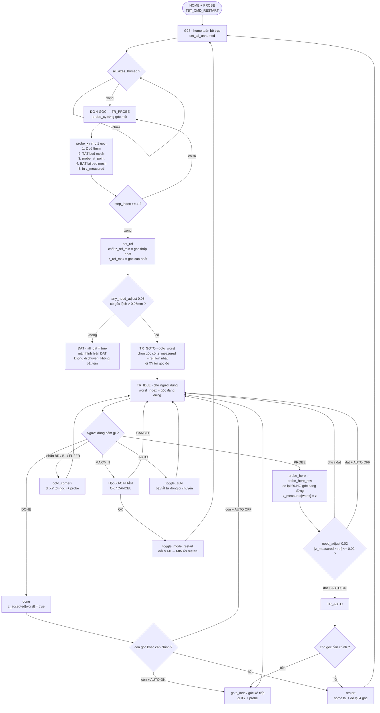
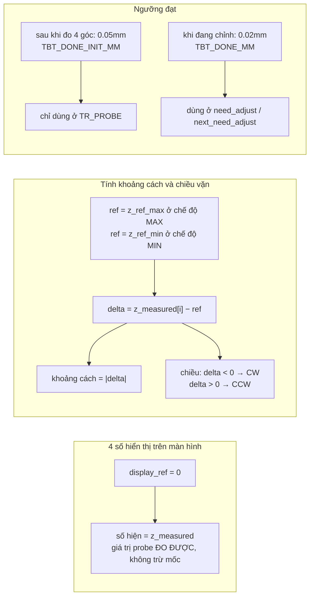
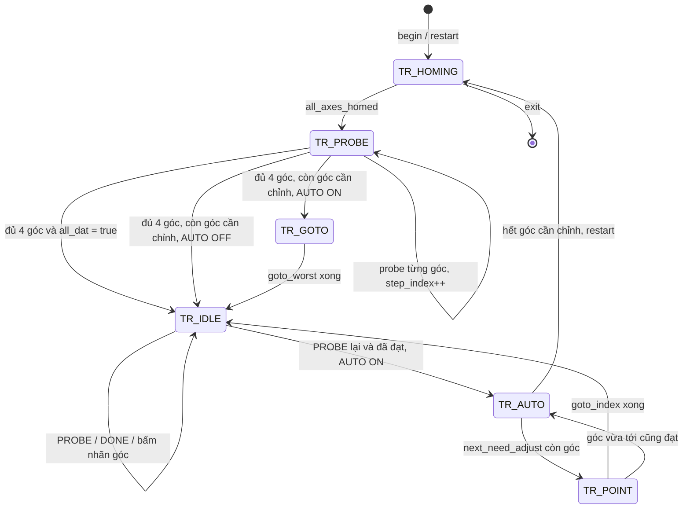
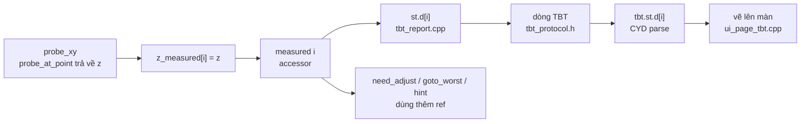
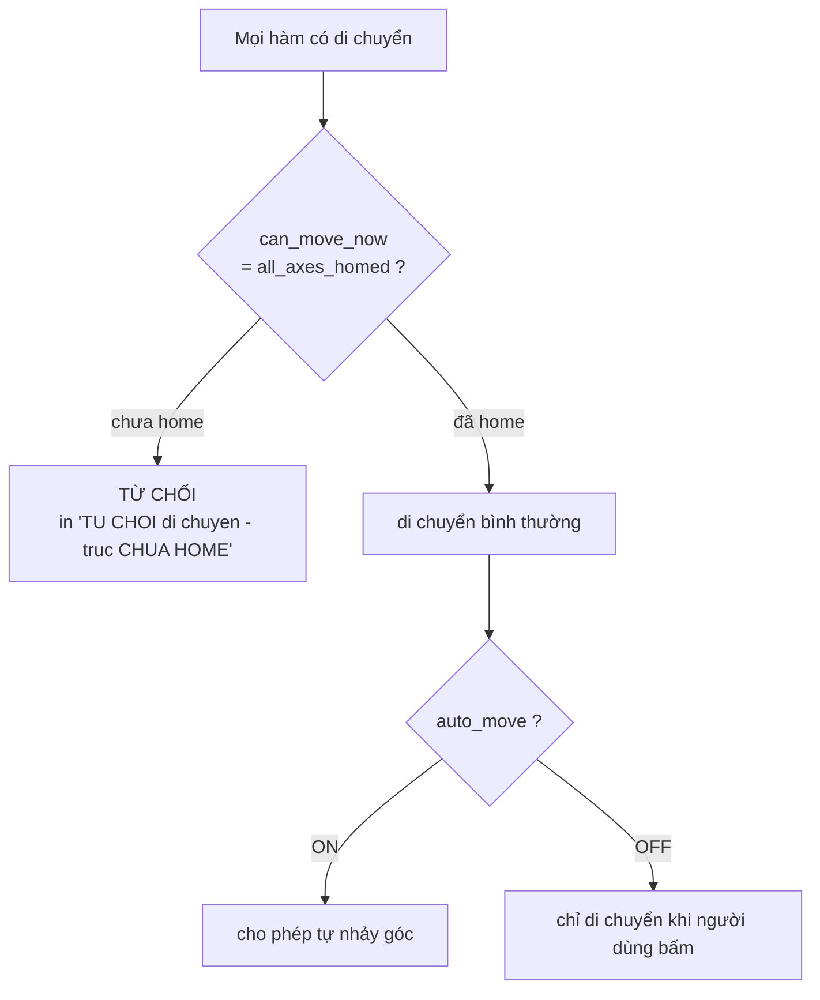

# Sơ đồ thuật toán Bed Tramming (wizard trên màn CYD)

Nguồn: `Marlin/src/feature/tbt_run.cpp`, `tbt_report.cpp`, `tbt_protocol.h`,
`cydlcd/src/ui/pages/ui_page_tbt.cpp`.

## 1. Luồng chính

## 2. Mốc so sánh và ngưỡng

## 3. Máy trạng thái

## 4. Đường đi của một con số

## 5. Chặn an toàn và điều kiện biên

## Bảng đối chiếu nhanh

| Khái niệm | Biến / hằng | Ý nghĩa |
|---|---|---|
| Số đo thô | `z_measured[i]` | probe trả về bao nhiêu, lưu bấy nhiêu |
| Mốc tính toán | `ref()` | Z-MAX ở chế độ MAX, Z-MIN ở chế độ MIN |
| Mốc hiển thị | `display_ref()` | luôn 0 → hiện đúng số đo thô |
| Sai lệch | `z_measured[i] − ref()` | dương = cao hơn mốc, âm = thấp hơn mốc |
| Ngưỡng sau 4 góc | `TBT_DONE_INIT_MM` = 0.05 | lệch nhỏ hơn coi như đạt luôn |
| Ngưỡng khi chỉnh | `TBT_DONE_MM` = 0.02 | phải vặn cho tới mức này |
| Chiều vặn | `tramming_turn_cw()` | delta âm → CW, dương → CCW |
| Tự động nhảy góc | `auto_move` | bật/tắt bằng nút AUTO |
| Chuỗi Z trước probe | `Z_CLEARANCE_BETWEEN_PROBES` = 5mm | duy nhất một lệnh, ở mọi đường |
| Bed mesh | tắt/bật quanh `probe_at_point` | đo không bị bù theo toạ độ XY |
| Chặn an toàn | `can_move_now()` | chỉ cho di chuyển khi đã home |
