# Sơ đồ toàn bộ màn hình 12864 (MKS_MINI_12864_V3)

> Trích từ code Marlin nhánh `mks-monster8-Voron-2.1.x` — 58 màn hình, 274 mục. Hai sơ đồ Mermaid bên dưới render trực tiếp trên GitHub.

Chú thích: `([])` = màn hình chính · `()` = menu · `{{}}` = màn hình đặc biệt · `[/ /]` = hộp thoại. Mũi tên liền = đi qua mục menu (nhãn trên mũi tên là tên mục). Mũi tên đứt nét = gọi khi có sự kiện runtime.

## 1. Sơ đồ tổng (điều hướng giữa các màn hình)

```mermaid
graph TD
    subgraph MÀN HÌNH CHÍNH
        n0(["Info Screen (Status)"])
    end
    subgraph MAIN MENU
        n1("Main")
    end
    subgraph MOTION
        n2("Build Mesh")
        n3("Build Custom Mesh")
        n4("Edit Mesh")
        n5("Grid Mesh Leveling")
        n6("Unified Bed Leveling")
        n7("Mesh Leveling")
        n8("Output Mesh Map")
        n9("Step-By-Step UBL")
        n10("Mesh Storage")
        n11("Validate Mesh")
        n12("Move E - Step")
        n13("Move X - Step")
        n14("Move Y - Step")
        n15("Move Z - Step")
        n16("Fill-in Mesh")
        n17("Adjust Mesh Height")
        n18("UBL Tools")
        n19("Homing")
        n20("Motion")
        n21("Move Axis")
        n22("Z Probe Wizard")
        n23{{"Manual Move"}}
        n24{{"Move Z (Wizard)"}}
        n25{{"Tramming Wizard"}}
        n26{{"Z Align Manual"}}
    end
    subgraph TEMPERATURE
        n27("Preheat ABS")
        n28("Preheat PETG")
        n29("Preheat PLA")
        n30("Temperature")
    end
    subgraph CONFIGURATION
        n31("Preheat ABS Settings")
        n32("Preheat PETG Settings")
        n33("Preheat PLA Settings")
        n34("Acceleration")
        n35("Filament")
        n36("Jerk")
        n37("Advanced Settings")
        n38("Steps/mm")
        n39("Temperature (Advanced)")
        n40("Max Speed (mm/s)")
        n41("Configuration")
        n42("Controller Fan")
        n43("Probe Offsets")
        n44("TMC Drivers")
        n45("Driver Current")
        n46("Hybrid Threshold")
        n47("Stepping Mode")
    end
    subgraph KHI ĐANG IN / SỰ KIỆN
        n48("Tune")
        n49("Print from Media")
        n50[/"Confirm Print"/]
        n51("Resume Options")
        n52("Change Filament")
        n53("Heat for Filament Op")
        n54[/"Confirm Dialog"/]
        n55{{"Kill Screen"}}
        n56{{"Please Wait"}}
        n57{{"Print Progress"}}
    end
    n1 -->|"Tune"| n48
    n1 -->|"Print from Media"| n49
    n1 -->|"Motion"| n20
    n1 -->|"Temperature"| n30
    n1 -->|"Configuration"| n41
    n20 -->|"Move Axis"| n21
    n20 -->|"Homing"| n19
    n20 -->|"Z Align Manual"| n26
    n20 -->|"Z Probe Wizard"| n22
    n20 -->|"Tramming Wizard"| n25
    n20 -->|"Unified Bed Leveling"| n6
    n21 -->|"Move X"| n13
    n21 -->|"Move Y"| n14
    n21 -->|"Move Z"| n15
    n21 -->|"Move Extruder"| n12
    n13 -->|"Move 10mm"| n23
    n14 -->|"Move 10mm"| n23
    n15 -->|"Move 10mm"| n23
    n12 -->|"Move 10mm"| n23
    n30 -->|"Preheat PLA"| n29
    n30 -->|"Preheat PETG"| n28
    n30 -->|"Preheat ABS"| n27
    n41 -->|"Advanced Settings"| n37
    n41 -->|"Controller Fan"| n42
    n41 -->|"Preheat PLA Settings"| n33
    n41 -->|"Preheat PETG Settings"| n32
    n41 -->|"Preheat ABS Settings"| n31
    n37 -->|"Max Speed"| n40
    n37 -->|"Acceleration"| n34
    n37 -->|"Jerk"| n36
    n37 -->|"Probe Offsets"| n43
    n37 -->|"Steps/mm"| n38
    n37 -->|"TMC Drivers"| n44
    n37 -->|"Temperature"| n39
    n37 -->|"Filament"| n35
    n43 -->|"Z Probe Wizard"| n22
    n44 -->|"Driver Current"| n45
    n44 -->|"Hybrid Threshold"| n46
    n44 -->|"Stepping Mode"| n47
    n6 -->|"Step-By-Step UBL"| n9
    n6 -->|"Mesh Storage"| n10
    n6 -->|"Output Mesh Map"| n8
    n6 -->|"UBL Tools"| n18
    n9 -->|"3. Validate Mesh"| n11
    n18 -->|"Build Mesh"| n2
    n18 -->|"Validate Mesh"| n11
    n18 -->|"Edit Mesh"| n4
    n18 -->|"Mesh Leveling"| n7
    n2 -->|"Build Custom Mesh"| n3
    n2 -->|"Fill-in Mesh"| n16
    n4 -->|"Adjust Mesh Height"| n17
    n7 -->|"Grid Mesh Leveling"| n5
    n22 -->|"Move 1mm"| n24
    n0 -.->|"đang in"| n57
    n1 -.->|"Tune khi đang in"| n48
    n1 -.->|"Print from Media"| n49
    n49 -.->|"chọn file"| n50
    n1 -.->|"tạm dừng in"| n51
    n1 -.->|"Change Filament"| n52
    n1 -.->|"hộp thoại Yes/No"| n54
    n0 -.->|"lỗi nghiêm trọng"| n55
    n0 -.->|"thao tác dài"| n56
```

## 2. Phụ lục: chi tiết từng màn hình

Mỗi nút liệt kê toàn bộ các mục bên trong: `&gt;` = mục dẫn sang màn hình khác (có mũi tên nối), `&lt;` = quay lại, `•` = thao tác/chỉnh giá trị. Điều kiện hiện/ẩn ghi trong `[...]`.

```mermaid
graph TD
    subgraph MÀN HÌNH CHÍNH
        m0(["Info Screen (Status)<br/>---<br/>(không có mục con)"])
    end
    subgraph MAIN MENU
        m1("Main<br/>---<br/>&lt; Info Screen<br/>• Pause Print [runtime: đang in (busy); ui.pause_print()]<br/>&gt; Tune [runtime: đang in (busy)]<br/>&gt; Print from Media [runtime: thẻ đã cắm (card_detected) và chưa mở file]<br/>• Attach SD Card [runtime: thẻ chưa cắm (NO_SD_DETECT: luôn hiện mục này khi c]<br/>• Resume Print [runtime: đang tạm dừng (printingIsPaused); ui.resume_print()]<br/>&gt; Motion<br/>&gt; Temperature<br/>&gt; Configuration<br/>• Change Filament [ADVANCED_PAUSE_FEATURE bật; hiện hộp thoại Yes/No xác nhận]")
    end
    subgraph MOTION
        m2("Build Mesh<br/>---<br/>&lt; UBL Tools<br/>&gt; Build Custom Mesh<br/>• Build Cold Mesh [G29NP1]<br/>&gt; Fill-in Mesh<br/>• Continue Bed Mesh [G29P1C]<br/>• Invalidate All [xóa toàn bộ mesh]<br/>• Invalidate Closest [G29I]<br/>• Info Screen [ui.return_to_status()]")
        m3("Build Custom Mesh<br/>---<br/>&lt; MSG_UBL_BUILD_MESH<br/>• Hotend Temp<br/>• Bed Temp<br/>• Build Custom Mesh [G29P1 với nhiệt độ đã nhập]")
        m4("Edit Mesh<br/>---<br/>&lt; UBL Tools<br/>• Fine Tune All [G29P4RT]<br/>• Fine Tune Closest [G29P4T]<br/>&gt; Adjust Mesh Height<br/>• Info Screen [ui.return_to_status()]")
        m5("Grid Mesh Leveling<br/>---<br/>&lt; UBL Tools<br/>• Side Points<br/>• (chạy G29J1 sau khi nhập) [G29J1]")
        m6("Unified Bed Leveling<br/>---<br/>&lt; Motion<br/>• Deactivate UBL [runtime: UBL đang bật; G29D]<br/>• Activate UBL [G29A]<br/>• Fade Height<br/>&gt; Step-By-Step UBL<br/>• Mesh Edit [vào màn hình chỉnh mesh trực quan]<br/>&gt; Mesh Storage<br/>&gt; Output Mesh Map<br/>&gt; UBL Tools<br/>• Output UBL Info [G29W]")
        m7("Mesh Leveling<br/>---<br/>&lt; UBL Tools<br/>• 3-Point Leveling [G29J0]<br/>&gt; Grid Mesh Leveling<br/>• Info Screen [ui.return_to_status()]")
        m8("Output Mesh Map<br/>---<br/>&lt; Unified Bed Leveling<br/>• Output for Host [G29T0]<br/>• Output for CSV [G29T1]<br/>• Off Printer Backup [G29S-1]")
        m9("Step-By-Step UBL<br/>---<br/>&lt; Unified Bed Leveling<br/>• 1. Build Cold Mesh [G29NP1]<br/>• 2. Smart Fill-in [G29P3T0]<br/>&gt; 3. Validate Mesh<br/>• 4. Fine Tune All [G29P4RT]<br/>&gt; 5. Validate Mesh<br/>• 6. Fine Tune All [G29P4RT]<br/>• 7. Save Bed Mesh [lưu mesh]")
        m10("Mesh Storage<br/>---<br/>&lt; Unified Bed Leveling<br/>• Memory Slot<br/>• Load Bed Mesh [đọc mesh từ slot]<br/>• Save Bed Mesh [lưu mesh vào slot]")
        m11("Validate Mesh<br/>---<br/>&lt; UBL Tools<br/>• Validate Custom Mesh [chạy G26 kiểm tra mesh]<br/>• Info Screen [ui.return_to_status()]")
        m12("Move E - Step<br/>---<br/>&lt; Move Axis<br/>&gt; Move 10mm<br/>&gt; Move 1mm<br/>&gt; Move 0.1mm<br/>&gt; Move 100mm [LARGE_AREA_TEST (bàn >= 300mm; máy này 305mm)]<br/>&gt; Move 50mm [LARGE_AREA_TEST]")
        m13("Move X - Step<br/>---<br/>&lt; Move Axis<br/>&gt; Move 10mm<br/>&gt; Move 1mm<br/>&gt; Move 0.1mm<br/>&gt; Move 100mm [LARGE_AREA_TEST (bàn >= 300mm; máy này 305mm)]<br/>&gt; Move 50mm [LARGE_AREA_TEST]")
        m14("Move Y - Step<br/>---<br/>&lt; Move Axis<br/>&gt; Move 10mm<br/>&gt; Move 1mm<br/>&gt; Move 0.1mm<br/>&gt; Move 100mm [LARGE_AREA_TEST (bàn >= 300mm; máy này 305mm)]<br/>&gt; Move 50mm [LARGE_AREA_TEST]")
        m15("Move Z - Step<br/>---<br/>&lt; Move Axis<br/>&gt; Move 10mm<br/>&gt; Move 1mm<br/>&gt; Move 0.1mm<br/>&gt; Move 100mm [LARGE_AREA_TEST (bàn >= 300mm; máy này 305mm)]<br/>&gt; Move 50mm [LARGE_AREA_TEST]")
        m16("Fill-in Mesh<br/>---<br/>&lt; MSG_UBL_BUILD_MESH<br/>• Fill-in Amount<br/>• Smart Fill-in [G29P3T0]<br/>• Manual Fill-in [G29P2BT0]<br/>• Info Screen [ui.return_to_status()]")
        m17("Adjust Mesh Height<br/>---<br/>&lt; MSG_UBL_EDIT_MESH<br/>• Height Amount<br/>• Info Screen [ui.return_to_status()]")
        m18("UBL Tools<br/>---<br/>&lt; Unified Bed Leveling<br/>&gt; Build Mesh<br/>• Manually Build Mesh [G29I999\nG29P2BT0]<br/>&gt; Validate Mesh<br/>&gt; Edit Mesh<br/>&gt; Mesh Leveling")
        m19("Homing<br/>---<br/>&lt; Motion<br/>• Auto Home [G28]")
        m20("Motion<br/>---<br/>&lt; Main<br/>&gt; Move Axis<br/>&gt; Homing<br/>• Auto Z-Align [G34]<br/>&gt; Z Align Manual<br/>• Deploy Z-Probe [PROBE_DEPLOY_STOW_MENU bật (probe cố định nên lệnh không có ]<br/>• Stow Z-Probe [PROBE_DEPLOY_STOW_MENU bật; M402]<br/>&gt; Z Probe Wizard<br/>&gt; Tramming Wizard<br/>• Worst Point = MAX [ASSISTED_TRAMMING: chọn hiển thị điểm tệ nhất (MAX) hay tốt ]<br/>&gt; Unified Bed Leveling<br/>• Level Bed [G29N]<br/>• Bed Leveling [runtime: đã home tất cả trục và mesh hợp lệ]<br/>• Fade Height<br/>• M48 Probe Test [G28O\nM48 P10]<br/>• Disable Steppers [M84]")
        m21("Move Axis<br/>---<br/>&lt; Motion<br/>• Soft Endstops [bool; BOTH(HAS_SOFTWARE_ENDSTOPS, SOFT_ENDSTOPS_MENU_ITEM)]<br/>&gt; Move X<br/>&gt; Move Y<br/>&gt; Move Z<br/>&gt; Move Extruder")
        m22("Z Probe Wizard<br/>---<br/>• Move Nozzle to Bed<br/>• Probe Z Offset<br/>&gt; Move 1mm<br/>&gt; Move 0.1mm")
        m23{{"Manual Move<br/>---<br/>(không có mục con)"}}
        m24{{"Move Z (Wizard)<br/>---<br/>(không có mục con)"}}
        m25{{"Tramming Wizard<br/>---<br/>(không có mục con)"}}
        m26{{"Z Align Manual<br/>---<br/>(không có mục con)"}}
    end
    subgraph TEMPERATURE
        m27("Preheat ABS<br/>---<br/>&lt; Temperature<br/>• Preheat ABS (Nozzle+Bed) [đặt nhiệt theo preset ABS]<br/>• Preheat ABS (Nozzle only) [đặt nhiệt nozzle theo preset ABS]")
        m28("Preheat PETG<br/>---<br/>&lt; Temperature<br/>• Preheat PETG (Nozzle+Bed) [đặt nhiệt theo preset PETG]<br/>• Preheat PETG (Nozzle only) [đặt nhiệt nozzle theo preset PETG]")
        m29("Preheat PLA<br/>---<br/>&lt; Temperature<br/>• Preheat PLA (Nozzle+Bed) [đặt nhiệt theo preset PLA]<br/>• Preheat PLA (Nozzle only) [đặt nhiệt nozzle theo preset PLA]")
        m30("Temperature<br/>---<br/>&lt; Main<br/>• Nozzle<br/>• Bed<br/>• Fan Speed [FAN_COUNT=1]<br/>&gt; Preheat PLA<br/>&gt; Preheat PETG<br/>&gt; Preheat ABS<br/>• Cooldown [runtime: đang có nhiệt (has_heat); tắt nhiệt hotend + bed]")
    end
    subgraph CONFIGURATION
        m31("Preheat ABS Settings<br/>---<br/>&lt; Configuration<br/>• Fan Speed<br/>• Nozzle Temp<br/>• Bed Temp<br/>• Store Settings [M500]")
        m32("Preheat PETG Settings<br/>---<br/>&lt; Configuration<br/>• Fan Speed<br/>• Nozzle Temp<br/>• Bed Temp<br/>• Store Settings [M500]")
        m33("Preheat PLA Settings<br/>---<br/>&lt; Configuration<br/>• Fan Speed<br/>• Nozzle Temp<br/>• Bed Temp<br/>• Store Settings [M500]")
        m34("Acceleration<br/>---<br/>&lt; Advanced Settings<br/>• Accel (printing)<br/>• Retract Accel<br/>• Travel Accel<br/>• Max X Accel<br/>• Max Y Accel<br/>• Max Z Accel<br/>• Max E Accel")
        m35("Filament<br/>---<br/>&lt; Advanced Settings<br/>• E in mm³ (volumetric) [NO_VOLUMETRICS tắt]<br/>• Filament Diameter [runtime: volumetric bật]<br/>• Unload Length (mm) [ADVANCED_PAUSE_FEATURE]<br/>• Load Length (mm) [ADVANCED_PAUSE_FEATURE]")
        m36("Jerk<br/>---<br/>&lt; Advanced Settings<br/>• Max X Jerk<br/>• Max Y Jerk<br/>• Max Z Jerk<br/>• Max E Jerk")
        m37("Advanced Settings<br/>---<br/>&lt; Configuration<br/>&gt; Max Speed<br/>&gt; Acceleration<br/>&gt; Jerk<br/>&gt; Probe Offsets [runtime: không bận; HAS_BED_PROBE]<br/>&gt; Steps/mm [runtime: không bận]<br/>&gt; TMC Drivers<br/>&gt; Temperature<br/>&gt; Filament")
        m38("Steps/mm<br/>---<br/>&lt; Advanced Settings<br/>• X Steps/mm<br/>• Y Steps/mm<br/>• Z Steps/mm<br/>• E Steps/mm")
        m39("Temperature (Advanced)<br/>---<br/>&lt; Advanced Settings<br/>• MPC Heater Power<br/>• MPC Block Heat Capacity<br/>• MPC Sensor Responsiveness<br/>• MPC Ambient Xfer Coeff<br/>• MPC Ambient Xfer w/ Fan [MPC_INCLUDE_FAN]<br/>• MPC Autotune [MPC_AUTOTUNE_MENU; M306 T]<br/>• Bed PID-P<br/>• Bed PID-I<br/>• Bed PID-D<br/>• Bed PID Autotune Temp [PID_AUTOTUNE_MENU]")
        m40("Max Speed (mm/s)<br/>---<br/>&lt; Advanced Settings<br/>• Max X Speed<br/>• Max Y Speed<br/>• Max Z Speed<br/>• Max E Speed<br/>• Min Velocity<br/>• Min Travel Speed")
        m41("Configuration<br/>---<br/>&lt; Main<br/>&gt; Advanced Settings<br/>• Probe Z Offset [FIX_MOUNTED_PROBE (Voron Tap)]<br/>&gt; Controller Fan<br/>&gt; Preheat PLA Settings<br/>&gt; Preheat PETG Settings<br/>&gt; Preheat ABS Settings<br/>• Store Settings [EEPROM_SETTINGS; M500 (lưu EEPROM)]<br/>• Load Settings [runtime: không bận; EEPROM_SETTINGS; M501 (đọc EEPROM)]<br/>• Restore Defaults [runtime: không bận; EEPROM_SETTINGS; M502 (về mặc định)]")
        m42("Controller Fan<br/>---<br/>&lt; Configuration<br/>• Idle Speed<br/>• Auto Mode<br/>• Active Speed [runtime: auto_mode bật]<br/>• Idle Period [runtime: auto_mode bật]")
        m43("Probe Offsets<br/>---<br/>&lt; Advanced Settings<br/>• Probe X Offset<br/>• Probe Y Offset<br/>• Probe Z Offset<br/>&gt; Z Probe Wizard")
        m44("TMC Drivers<br/>---<br/>&lt; Advanced Settings<br/>&gt; Driver Current<br/>&gt; Hybrid Threshold<br/>&gt; Stepping Mode")
        m45("Driver Current<br/>---<br/>&lt; TMC Drivers<br/>• X Current (mA)<br/>• Y Current (mA)<br/>• Z Current (mA)<br/>• Z2 Current (mA)<br/>• Z3 Current (mA)<br/>• E0 Current (mA)")
        m46("Hybrid Threshold<br/>---<br/>&lt; TMC Drivers<br/>• X Hybrid Thrs<br/>• Y Hybrid Thrs<br/>• Z Hybrid Thrs<br/>• Z2 Hybrid Thrs<br/>• Z3 Hybrid Thrs<br/>• E0 Hybrid Thrs")
        m47("Stepping Mode<br/>---<br/>&lt; TMC Drivers<br/>• StealthChop Enabled<br/>• X StealthChop<br/>• Y StealthChop<br/>• Z StealthChop<br/>• Z2 StealthChop<br/>• Z3 StealthChop<br/>• E0 StealthChop")
    end
    subgraph KHI ĐANG IN / SỰ KIỆN
        m48("Tune<br/>---<br/>&lt; Main<br/>• Speed<br/>• Nozzle<br/>• Bed<br/>• Fan Speed<br/>• Flow")
        m49("Print from Media<br/>---<br/>&lt; Main<br/>• Refresh [mount lại thẻ]<br/>• .. (lên thư mục cha) [lcd_sd_updir]<br/>• Danh sách file/thư mục trên thẻ [runtime: duyệt file .gcode; chọn file = hiện hộp thoại xác n]")
        m50[/"Confirm Print<br/>---<br/>• Yes [bắt đầu in file đã chọn]<br/>&lt; No"/]
        m51("Resume Options<br/>---<br/>• RESUME OPTIONS:<br/>• Purge More [runtime: còn kẹt (still_out); đùn thêm nhựa]<br/>• Continue [tiếp tục in]")
        m52("Change Filament<br/>---<br/>(không có mục con)")
        m53("Heat for Filament Op<br/>---<br/>&lt; Back<br/>• Chọn preset nhiệt (PLA/PETG/ABS)")
        m54[/"Confirm Dialog<br/>---<br/>(không có mục con)"/]
        m55{{"Kill Screen<br/>---<br/>(không có mục con)"}}
        m56{{"Please Wait<br/>---<br/>(không có mục con)"}}
        m57{{"Print Progress<br/>---<br/>(không có mục con)"}}
    end
    m1 -->|"Tune"| m48
    m1 -->|"Print from Media"| m49
    m1 -->|"Motion"| m20
    m1 -->|"Temperature"| m30
    m1 -->|"Configuration"| m41
    m20 -->|"Move Axis"| m21
    m20 -->|"Homing"| m19
    m20 -->|"Z Align Manual"| m26
    m20 -->|"Z Probe Wizard"| m22
    m20 -->|"Tramming Wizard"| m25
    m20 -->|"Unified Bed Leveling"| m6
    m21 -->|"Move X"| m13
    m21 -->|"Move Y"| m14
    m21 -->|"Move Z"| m15
    m21 -->|"Move Extruder"| m12
    m13 -->|"Move 10mm"| m23
    m14 -->|"Move 10mm"| m23
    m15 -->|"Move 10mm"| m23
    m12 -->|"Move 10mm"| m23
    m30 -->|"Preheat PLA"| m29
    m30 -->|"Preheat PETG"| m28
    m30 -->|"Preheat ABS"| m27
    m41 -->|"Advanced Settings"| m37
    m41 -->|"Controller Fan"| m42
    m41 -->|"Preheat PLA Settings"| m33
    m41 -->|"Preheat PETG Settings"| m32
    m41 -->|"Preheat ABS Settings"| m31
    m37 -->|"Max Speed"| m40
    m37 -->|"Acceleration"| m34
    m37 -->|"Jerk"| m36
    m37 -->|"Probe Offsets"| m43
    m37 -->|"Steps/mm"| m38
    m37 -->|"TMC Drivers"| m44
    m37 -->|"Temperature"| m39
    m37 -->|"Filament"| m35
    m43 -->|"Z Probe Wizard"| m22
    m44 -->|"Driver Current"| m45
    m44 -->|"Hybrid Threshold"| m46
    m44 -->|"Stepping Mode"| m47
    m6 -->|"Step-By-Step UBL"| m9
    m6 -->|"Mesh Storage"| m10
    m6 -->|"Output Mesh Map"| m8
    m6 -->|"UBL Tools"| m18
    m9 -->|"3. Validate Mesh"| m11
    m18 -->|"Build Mesh"| m2
    m18 -->|"Validate Mesh"| m11
    m18 -->|"Edit Mesh"| m4
    m18 -->|"Mesh Leveling"| m7
    m2 -->|"Build Custom Mesh"| m3
    m2 -->|"Fill-in Mesh"| m16
    m4 -->|"Adjust Mesh Height"| m17
    m7 -->|"Grid Mesh Leveling"| m5
    m22 -->|"Move 1mm"| m24
    m0 -.->|"đang in"| m57
    m1 -.->|"Tune khi đang in"| m48
    m1 -.->|"Print from Media"| m49
    m49 -.->|"chọn file"| m50
    m1 -.->|"tạm dừng in"| m51
    m1 -.->|"Change Filament"| m52
    m1 -.->|"hộp thoại Yes/No"| m54
    m0 -.->|"lỗi nghiêm trọng"| m55
    m0 -.->|"thao tác dài"| m56
```

*Ghi chú: `MKS_MINI_12864_V3` hiện đang tắt trong config (do `CYDLCD_SERIAL_UI` bật); sơ đồ giả định đã bật lại màn 12864.*
