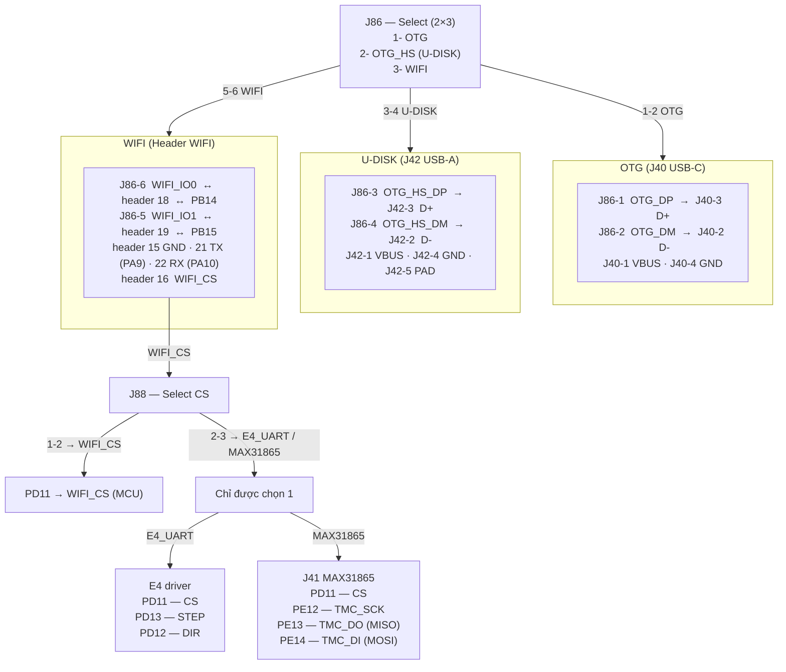
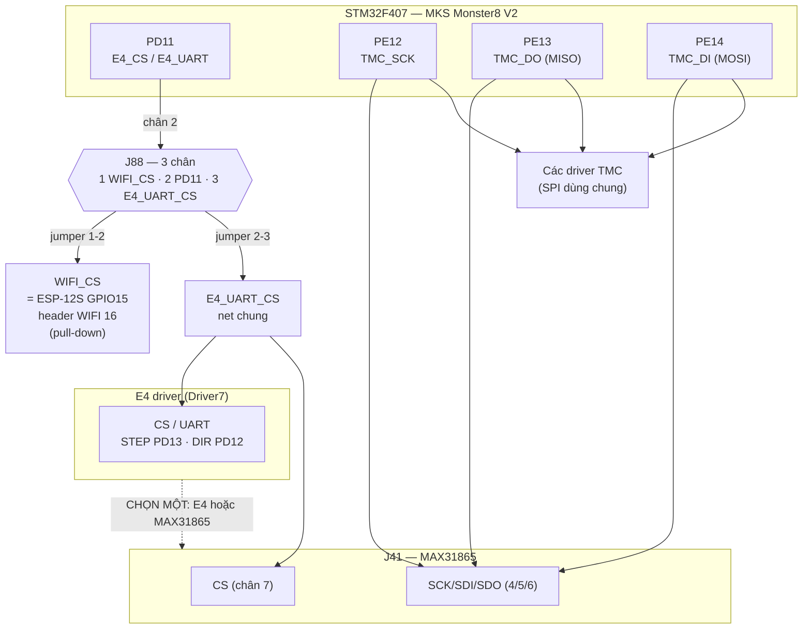

# MKS Monster8 V2 — SƠ ĐỒ CHÂN (bản text)

> **Nguồn dữ liệu**
> - `Marlin/src/pins/stm32f4/pins_MKS_MONSTER8_V2.h`
> - `Marlin/src/pins/stm32f4/pins_MKS_MONSTER8_common.h`
> - README §7 (các chân đã kiểm chứng bằng `M43` trên chính máy này)
> - `pins_MKS_MONSTER8_V2.h:54-61` (WIFI), `:63` (NEOPIXEL2)
>
> ⚠️ **Thứ tự chân vật lý** của các header 2.54 mm: firmware chỉ định nghĩa *tín hiệu ↔ chân MCU*.
> Riêng header WIFI 16 chân đã được chốt theo **tài liệu chính thức MKS V2** ở **§3.17**; các
> header khác vẫn nên đối chiếu silkscreen hoặc đo thông mạch.

---

## 1. Tóm tắt board

| | |
|---|---|
| MCU | **STM32F407VGT6** (LQFP100), 1 MB flash, 128 KB RAM |
| Firmware | Marlin 2.1.2, env `mks_monster8`, nạp tại `0x0800C000` |
| Driver | 8 khe: **X, Y, Z, E0, Z2, Z3, Z4, E4** (TMC2209 — software UART) |
| Thermistor | 4 kênh: **TH0, TH1, TH2, TB** |
| Heater | 3 kênh: **HE0, HE1, HE2** + **H-BED** |
| Quạt | 3 kênh có PWM: **FAN0 (LA), FAN1 (HE), FAN2 (controller)** |
| Màn hình | **EXP1 / EXP2** (2×5) cho 12864; **WIFI** cho USART1 (CYD đang dùng) |
| Lưu trữ | **TF/microSD** onboard (SPI3) + **USB** (OTG FS) |
| EEPROM | I2C 4 KB (**PB8/PB9**) |
| Nguồn | 24 V; 5 V/3 A ra; jumper USB |

---

## 2. Sơ đồ khối (logic — không theo tỉ lệ/vị trí vật lý)

```
                        ┌───────────────────────────────────────────────┐
                        │            STM32F407VGT6 (LQFP100)             │
                        │                                               │
   USB-C (OTG FS) ──────┤ PA11 (D-) / PA12 (D+)       [chuẩn STM32]      │
   TF/microSD (SPI3) ───┤ PC9(CS) PC10(SCK) PC11(MISO) PC12(MOSI) PC4(CD)│
   EEPROM I2C 4KB ──────┤ PB8 (SCL) / PB9 (SDA)                           │
                        │                                               │
   Driver X  (D0) ──────┤ PC15(EN) PC14(STEP) PC13(DIR)  PE6 (UART/CS)   │
   Driver Y  (D1) ──────┤ PC15(EN) PE5 (STEP) PE4 (DIR)   PE3 (UART/CS)   │
   Driver Z  (D2) ──────┤ PE2 (EN) PE1 (STEP) PE0 (DIR)   PB7 (UART/CS)   │
   Driver E0 (D3) ──────┤ PB6 (EN) PB5 (STEP) PB4 (DIR)   PB3 (UART/CS)   │
   Driver Z2 (D4) ──────┤ PD7 (EN) PD6 (STEP) PD5 (DIR)   PD4 (UART/CS)   │
   Driver Z3 (D5) ──────┤ PD3 (EN) PD2 (STEP) PD1 (DIR)   PD0 (UART/CS)   │
   Driver Z4 (D6) ──────┤ PC8 (EN) PC7 (STEP) PC6 (DIR)   PD15(UART/CS)   │
   Driver E4 (D7) ──────┤ PB6 (EN)* PD13(STEP) PD12(DIR)  PD11(UART/CS)   │
                        │                                               │
   Endstop ─────────────┤ PA14(X-) PA15(Y-) PB13(Z-) PB12(Z+) PA13(X+)    │
   Probe ───────────────┤ PB13 (Z_PROBE) + PA8 (PROBE_ENABLE/servo)       │
   Thermistor ──────────┤ PC1(TH0) PC2(TH1) PC3(TH2) PC0(TB)             │
   Heater ──────────────┤ PB1(HE0) PB0(HE1) PA3(HE2) PB10(H-BED)         │
   Fan ─────────────────┤ PA2(FAN0) PA1(FAN1) PA0(FAN2)                  │
   Neopixel ────────────┤ PC5 (NEOPIXEL2) · PD8 (NEOPIXEL via EXP1_06)    │
                        │                                               │
   EXP1 (2×5) ──────────┤ PB2 PE10 PE11 PD10 PD9 PD8 PE15 PE7 + 5V/GND  │
   EXP2 (2×5) ──────────┤ PA6 PA5 PE9 PA4 PE8 PA7 PB11 RESET + 3V3/GND  │
   WIFI ────────────────┤ PA9(TX) PA10(RX) PB14(IO0) PB15(IO1) PD14(RST) │
                        └───────────────────────────────────────────────┘
   * E4_ENABLE_PIN (V2) = PB6, trùng E0_ENABLE_PIN (common) → E0 và E4 dùng chung enable.
```

---

## 3. Bảng chân chi tiết

### 3.1 Driver (TMC2209 — software UART, `TMC_BAUD_RATE 19200`)

| Khe | EN | STEP | DIR | UART/CS | DIAG (dùng chung endstop) |
|---|---|---|---|---|---|
| **X** (Driver0) | PC15 | PC14 | PC13 | PE6 | PA14 → `X-` |
| **Y** (Driver1) | PC15 | PE5 | PE4 | PE3 | PA15 → `Y-` |
| **Z** (Driver2) | PE2 | PE1 | PE0 | PB7 | PB13 → `Z-` |
| **E0** (Driver3) | PB6 | PB5 | PB4 | PB3 | PA13 → `X+` |
| **Z2** (Driver4) | PD7 | PD6 | PD5 | PD4 | PC5 → `Y+` |
| **Z3** (Driver5) | PD3 | PD2 | PD1 | PD0 | PB12 → `Z+` |
| **Z4** (Driver6) | PC8 | PC7 | PC6 | PD15 | — |
| **E4** (Driver7) | PB6* | PD13 | PD12 | PD11 | — |

\* `E4_ENABLE_PIN` khai báo ở `pins_MKS_MONSTER8_V2.h:37` = **PB6**, trùng `E0_ENABLE_PIN` (common) → E0/E4 chung chân enable.

**TMC software SPI** (nếu dùng TMC2130): MOSI **PE14**, MISO **PE13**, SCK **PE12**.

### 3.2 Endstop / probe

| Chức năng | Chân | Header | Ghi chú |
|---|---|---|---|
| `X_MIN_PIN` | **PA14** | `X-` | ≡ `X_DIAG_PIN` |
| `Y_MIN_PIN` | **PA15** | `Y-` | ≡ `Y_DIAG_PIN` |
| `Z_MIN_PIN` / `Z_PROBE_PIN` | **PB13** | `Z-` | ≡ `Z_DIAG_PIN` |
| `Z_MAX_PIN` | **PB12** | `Z+` | ≡ `E2_DIAG_PIN` / `PW_OFF` / `FIL_RUNOUT2` |
| `X+` / `FIL_RUNOUT_PIN` | **PA13** | `X+` | ≡ `E0_DIAG_PIN` / `MT_DET_1` |
| `Y+` | **PC5** | `Y+` | ≡ `E1_DIAG_PIN` / `NEOPIXEL2_PIN` |
| `PROBE_ENABLE_PIN` | **PA8** | servo | bật/tắt mạch cảm biến (BLTouch...) |

### 3.3 Thermistor

| Kênh | Chân | Header |
|---|---|---|
| TH0 (nozzle) | **PC1** | `TH0` |
| TH1 | **PC2** | `TH1` |
| TH2 | **PC3** | `TH2` |
| TB (bed) | **PC0** | `TB` |

### 3.4 Heater / fan

| Chức năng | Chân | Header |
|---|---|---|
| HE0 | **PB1** | `HE0` |
| HE1 | **PB0** | `HE1` |
| HE2 | **PA3** | `HE2` |
| H-BED | **PB10** | `H-BED` |
| FAN0 (LA FAN) | **PA2** | `FAN0` |
| FAN1 (HE FAN) | **PA1** | `FAN1` |
| FAN2 (controller) | **PA0** | `FAN2` |

### 3.5 EXP1 (2×5) — màn 12864

```
        EXP1
   (BEEPER) PB2  1  2  PE10 (BTN_ENC)
   (LCD_EN) PE11 3  4  PD10 (LCD_RS)
   (LCD_D4) PD9  5  6  PD8  (LCD_D5)  ← PD8 cũng là NEOPIXEL_PIN
   (LCD_D6) PE15 7  8  PE7  (LCD_D7)
             GND 9 10  5V
```

| Chân | 1 | 3 | 5 | 7 | 9 |
|---|---|---|---|---|---|
| Tín hiệu | PB2 (BEEPER) | PE11 (LCD_EN) | PD9 (LCD_D4) | PE15 (LCD_D6) | GND |
| Chân | 2 | 4 | 6 | 8 | 10 |
| Tín hiệu | PE10 (BTN_ENC) | PD10 (LCD_RS) | PD8 (LCD_D5 / NEOPIXEL) | PE7 (LCD_D7) | 5V |

### 3.6 EXP2 (2×5) — SPI cho màn/TF

```
        EXP2
   (SPI1 MISO) PA6 1  2  PA5 (SPI1 SCK)
   (BTN_EN1)   PE9 3  4  PA4 (SPI1 CS)
   (BTN_EN2)   PE8 5  6  PA7 (SPI1 MOSI)
   (SPI1_RS)   PB11 7 8  RESET
               GND 9 10  3.3V
```

### 3.7 WIFI — header cho module MKS ESP-WIFI (CYD đang dùng)

| Nhãn | Chân MCU | Ghi chú |
|---|---|---|
| `TX` | **PA9** | USART1_TX → CYD `GPIO35` (RX) |
| `RX` | **PA10** | USART1_RX ← CYD `GPIO22` (TX) |
| `IO0` | **PB14** | free (GPIO) |
| `IO1` | **PB15** | free (GPIO) |
| `RST` | **PD14** | free (GPIO) |
| `5V` / `GND` | — | nguồn / mass chung |

**Về 16 chân vật lý:** xem bảng chốt đầy đủ ở **§3.17** (theo tài liệu chính thức MKS V2):
hàng A = 1→8, hàng B = 22→15, gồm `RST`, `EN`, `SPI2_HSPI_*`, `3V3`, `GND`, `WIFI_CS`,
`WIFI_IO0/IO1`, `TX`, `RX` và các chân NC.

Cách xác định chân free bằng đồng hồ (không cấp điện):
- Que 1 vào **PB14** (chân IC hoặc pad), que 2 dò từng pad header → pad thông = `IO0`.
- Tương tự **PB15** → `IO1`, **PD14** → `RST`.
- `PA9`/`PA10` đã có dây CYD nên dễ nhận.

### 3.8 SD card (onboard, SPI3) / EEPROM / Neopixel / USB

| Chức năng | Chân |
|---|---|
| SD CS (`SDSS`) | **PC9** |
| SD SCK | **PC10** |
| SD MISO | **PC11** |
| SD MOSI | **PC12** |
| SD detect | **PC4** |
| I2C EEPROM SCL | **PB8** |
| I2C EEPROM SDA | **PB9** |
| Neopixel 2 | **PC5** (dùng chung `Y+`/`E1_DIAG`) |
| Neopixel (qua EXP1_06) | **PD8** |
| USB OTG FS | **PA11 / PA12** (chuẩn STM32F407) |

### 3.9 Jumper **J86** — chọn **U-DISK / WIFI** (mặt dưới board)

Theo bản vẽ **BOTTOM** của MKS (`MKS Monster8 V2.0_002 BOTTOM.pdf`) có jumper chọn
**WiFi module** hoặc **UDisk (USB-A)**. Về mặt tín hiệu, hai chế độ này **dùng chung**
cặp chân USB OTG_HS của STM32:

| Chế độ jumper | PB14 (D-) | PB15 (D+) | Đích đến |
|---|---|---|---|
| **WIFI** | `WIFI_IO0_PIN` | `WIFI_IO1_PIN` | header WIFI (module MKS ESP-WIFI) |
| **UDISK** | USB OTG_HS D- | USB OTG_HS D+ | cổng USB-A (UDisk) |

Hệ quả với firmware:

- `MKS_WIFI_MODULE` (dùng PB14/PB15/PD14 cho ESP) **và** `USB_FLASH_DRIVE_SUPPORT`
  (dùng USB-A) **không thể bật cùng lúc** — đúng như MKS ghi: *"TF card và UDisk không dùng đồng thời"*.
- Build hiện tại: `MKS_WIFI_MODULE` **tắt**, `USB_FLASH_DRIVE_SUPPORT` **tắt**, CYD chỉ dùng
  **PA9/PA10** ⇒ jumper ở vị trí nào cũng **không ảnh hưởng màn CYD**.
- Nếu muốn dùng **PB14/PB15 làm GPIO** (hoặc cắm module WiFi): jumper phải ở vị trí **WIFI**
  để 2 chân này thông xuống header WIFI. Nếu jumper ở **UDISK**, PB14/PB15 đi ra cổng USB-A
  và **header WIFI không còn IO0/IO1**.
- Nếu cắm module ESP vào header WIFI thì **không được dùng PB14/PB15 cho việc khác**
  (module sẽ kéo/điều khiển 2 chân này).

Chi tiết chân của **J86** (trích từ `MKS Monster8 V2.0_003 SCH.pdf`, sheet **USB**):

| Chân | Net | Ý nghĩa |
|---|---|---|
| 1 | `OTG_DP` | USB-C (OTG FS) D+ |
| 2 | `OTG_DM` | USB-C (OTG FS) D- |
| 3 | `OTG_HS_DP` | USB-A (U-DISK) D+ |
| 4 | `OTG_HS_DM` | USB-A (U-DISK) D- |
| 5 | `WIFI_IO1` | module WiFi (≡ PB15) |
| 6 | `WIFI_IO0` | module WiFi (≡ PB14) |

Nhãn trên schematic: **"Select — U-DISK or WIFI"**. Ba cặp chọn: **(1-2)** OTG (USB-C),
**(3-4)** U-DISK (USB-A), **(5-6)** WIFI. Đặt jumper theo cặp cần dùng; **không bật
`MKS_WIFI_MODULE` và `USB_FLASH_DRIVE_SUPPORT` cùng lúc**.

> ⚠️ File `...V2.0_002 BOTTOM.pdf` là bản in vector (**không có text**), nên không trích
> được nhãn. Bản `...V2.0_003 SCH.pdf` là **KiCad PDF có text** — toàn bộ số liệu J86/J88/J41/
> J42/M8 trong tài liệu này lấy từ đó. Vẫn nên đối chiếu silkscreen jumper trên board thật.

### 3.10 **J41** — header module MAX31865 (8 chân)

| Chân | Net | Chức năng |
|---|---|---|
| 1 | `VCC` | 3.3 V cho module |
| 2 | `GND` | mass |
| 3 | — | NC |
| 4 | `TMC_SCK` | SCK (SPI dùng chung TMC) |
| 5 | `TMC_DO` | SDO (MISO) |
| 6 | `TMC_DI` | SDI (MOSI) |
| 7 | `E4_UART_CS` | CS (xem J88) |
| 8 | — | NC |

> `J41` **không phải** jumper chọn WiFi/UDisk (đó là **J86**). Đây là header cắm module
> cảm biến nhiệt độ **MAX31865** (PT100/PT1000), dùng chung bus SPI với TMC.

### 3.11 **J88** — chọn nguồn CS cho MAX31865 / E4 driver (3 chân)

| Chân | Net | Chức năng |
|---|---|---|
| 1 | `WIFI_CS` | CS từ khối WiFi |
| 2 | `PD11` | CS do MCU điều khiển (E4_CS) |
| 3 | `E4_UART_CS` | CS dùng chung E4 UART |

Nhãn schematic: **"31865_CS and E4-Driver_CS"**. Chọn 1 trong 3 nguồn CS.

### 3.12 **J42** — cổng USB-A (UDisk)

| Chân | Net |
|---|---|
| 1 | `VBUS` (5 V) |
| 2 | `D-` |
| 3 | `D+` |
| 4 | `GND` |
| 5 | `PAD` (vỏ) |

### 3.13 **J20 / J21 / J22 / J26** — header thermistor (2 chân)

| Header | Chân 1 | Chân 2 | Dùng cho |
|---|---|---|---|
| **J20** | `TEMP0` (PC1) | `GND` | TH0 — nozzle |
| **J21** | `TEMP1` (PC2) | `GND` | TH1 |
| **J22** | `TEMP2` (PC3) | `GND` | TH2 |
| **J26** | `TEMPHB` (PC0) | `GND` | TB — bed |

Mỗi header có jumper **JP1–JP4** để chọn pull-up/ngắt cảm biến (net `+3.3V`).

### 3.14 **J1** — header SWD (nạp/debug, 6 chân)

| Chân | Net |
|---|---|
| 1 | `SW_DIO` |
| 2 | `+3.3V` |
| 3 | `SW_CLK` |
| 4 | `GND` |
| 5 | `RESET` |
| 6 | `RESET` |

### 3.15 **J2 / J3 / J7** — header CAN + I2C

| Chân | **J2** (6 chân, "I2C or CAN") | **J3** (4 chân, CAN) | **J7** (4 chân, I2C) |
|---|---|---|---|
| 1 | `CAN1_TX` | `VCC` | `VCC` |
| 2 | `CAN1_RX` | `GND` | `GND` |
| 3 | `I2C1_SDA` | `CAN1_RX` | `SCL` |
| 4 | `I2C1_SCL` | `CAN1_TX` | `SDA` |
| 5 | `SDA` | — | — |
| 6 | `SCL` | — | — |

> Số liệu đọc trực tiếp từ tọa độ chữ trong `MKS Monster8 V2.0_003 SCH.pdf` (sheet MCU).

### 3.16 Module **MKS Robin WIFI V1.1** (ESP-12S) — cắm vào header WIFI 16 chân

Đây chính là module mà header WIFI 2×8 (16 chân) của mainboard được thiết kế để cắm vào.
Schematic module: `MKS-WIFI/hardware/MKS Robin WIFI V1.1_001/... SCH.pdf` (1 trang, ESP-12S).

**Connector J1 = 2×8 (16 chân)**, chia 2 hàng `J1A` (8 chân) và `J1B` (8 chân). Các net có mặt
trên J1 (trích từ schematic module):

| Nhóm | Tín hiệu |
|---|---|
| Nguồn | `3V3`, `GND` |
| Điều khiển ESP | `RST`, `EN`, `IO0`, `IO1`, `IO2` |
| UART | `TX`, `RX` |
| HSPI (dùng chung chân IO) | `SPI2_HSPI_CLK`, `SPI2_HSPI_MISO`, `SPI2_HSPI_MOSI` |

Ghép với mainboard:

| Module J1 | Mainboard WIFI header | Chân MCU |
|---|---|---|
| `TX` | `RX` (chéo) | **PA10** |
| `RX` | `TX` (chéo) | **PA9** |
| `IO0` | `IO0` | **PB14** (qua J86) |
| `IO1` | `IO1` | **PB15** (qua J86) |
| `RST` | `RST` | **PD14** |
| `3V3` / `GND` | nguồn trên header | đo trước khi cắm |

> ⚠️ Module ESP-12S chạy **3.3 V**. Header WIFI của mainboard có thể ra **5 V** (CYD đang dùng 5 V)
> hoặc 3V3 tuỳ board — **đo bằng đồng hồ trước khi cắm module**, không đưa 5 V thẳng vào ESP-12S.

> ⚠️ **Thứ tự chân 1–16 của J1A/J1B**: text của schematic module bị layout chồng chéo
> (nhiều nhãn `SPI2_HSPI_*`, `IO1/IO2` nằm lẫn giữa ký hiệu ESP-12S), nên **không trích được
> chính xác thứ tự vật lý** chỉ bằng text. Muốn chốt: đọc silkscreen trên module (có in số chân
> J1) hoặc đo thông mạch từ chân ESP-12S ra J1. Khi có thứ tự, điền vào bảng trên là đủ để
> biết header 16 chân của mainboard.

### 3.16a Quan hệ **J86** — OTG / U-DISK / WIFI (Mermaid)

J86 là selector **2×3**, ba vị trí: **1 = OTG**, **2 = U-DISK**, **3 = WIFI** — tương ứng
ba cặp jumper **1-2 / 3-4 / 5-6**. Mỗi cặp dẫn xuống một khối có danh sách pin; khối
**WIFI (5-6)** nối tiếp sang **J88** cho đường `WIFI_CS`.



| Vị trí | Jumper | Khối | Đấu chân |
|---|---|---|---|
| **1** | 1-2 | OTG (J40 USB-C) | J86-1 `OTG_DP` → J40-3 `D+` · J86-2 `OTG_DM` → J40-2 `D-` |
| **2** | 3-4 | U-DISK (J42 USB-A) | J86-3 `OTG_HS_DP` → J42-3 `D+` · J86-4 `OTG_HS_DM` → J42-2 `D-` |
| **3** | 5-6 | WIFI (header) | J86-6 `WIFI_IO0` ↔ header 18 ↔ **PB14** · J86-5 `WIFI_IO1` ↔ header 19 ↔ **PB15** |

**J88 (đi tiếp từ khối WIFI qua `WIFI_CS`):**

| Jumper | Đấu chân |
|---|---|
| **1-2** | header 16 `WIFI_CS` (ESP GPIO15) ↔ **PD11** (STM32 điều khiển GPIO15 ESP) |
| **2-3** | **PD11** ↔ `E4_UART_CS` → **E4 driver** *hoặc* **J41 MAX31865** (chọn một) |

| Khối 2-3 | Pin |
|---|---|
| **E4 driver** | `PD11` — CS · `PD13` — STEP · `PD12` — DIR |
| **J41 MAX31865** | `PD11` — CS (J41-7) · `PE12` — SCK (J41-4) · `PE13` — DO/MISO (J41-5) · `PE14` — DI/MOSI (J41-6) |

> `J86` và `J88` **độc lập**: J86 chọn IO0/IO1 (PB14/PB15) ra header; J88 chọn PD11 đi
> `WIFI_CS` hay `E4_UART_CS`. Muốn PB14/PB15 ra header 18/19 thì J86 = **5-6**.

### 3.17 Header WIFI 16 chân — bảng chốt (theo tài liệu chính thức MKS V2)

Header là **2×8** nằm trong footprint **22 chân** của ESP-12S, nên hàng B đánh số **15→22**
(không phải 9→16). Hai hàng đối nhau:

```
        cột 1   cột 2   cột 3   cột 4   cột 5   cột 6   cột 7   cột 8
J1A:      1       2       3       4       5       6       7       8
J1B:     22      21      20      19      18      17      16      15
```

| Pin | Hàng | Net | Ghi chú |
|---|---|---|---|
| **1** | A1 | `RST` | reset ESP  → PD14 |
| 2 | A2 | NC | |
| **3** | A3 | `EN` (3V3) | enable ESP |
| 4 | A4 | NC | |
| 5 | A5 | `SPI2_HSPI_CLK` | |
| 6 | A6 | `SPI2_HSPI_MISO` | |
| 7 | A7 | `SPI2_HSPI_MOSI` | |
| **8** | A8 | `3V3` | nguồn module |
| **15** | B8 | `GND` | mass chung |
| 16 | B7 | `WIFI_CS (ESP IC)` | **pull-down** |
| 17 | B6 | NC | |
| **18** | B5 | `WIFI_IO0` | **pull-up** → **PB14** |
| **19** | B4 | `WIFI_IO1` | **pull-up** → **PB15** |
| 20 | B3 | NC | |
| **21** | B2 | `TX` | → **PA9** |
| **22** | B1 | `RX` | → **PA10** |

**Nối CYD:**
- `21 (TX)` → CYD **RX** (GPIO35)
- `22 (RX)` ← CYD **TX** (GPIO22)
- `15 (GND)` chung mass
- CYD lấy **nguồn ngoài** (không dùng 3V3/5V của header)

**Dùng PB14/PB15 làm GPIO:** ra chân **18/19**, nhưng phải để **J86 ở vị trí WIFI**; hai chân
này có **pull-up** trên board (đo tĩnh thấy 3,3 V là bình thường, không phải lỗi).

### 3.17b Quan hệ **J88 / E4 / MAX31865 / WIFI_CS** (Mermaid)



| Tín hiệu | Chân | Ghi chú |
|---|---|---|
| `E4_CS` / `E4_UART` | **PD11** | chân chung J88-2 |
| `WIFI_CS` | header WIFI **16** | ESP-12S GPIO15, pull-down |
| `E4_UART_CS` | J88-3 | nối tới E4 driver **và** J41 MAX31865 |
| `TMC_SCK/DO/DI` | **PE12 / PE13 / PE14** | SPI dùng chung |
| MAX31865 CS / SPI | J41-7 / J41-4,5,6 | CS = `E4_UART_CS` |

> J88 chọn **PD11 đi đâu**, không liên quan J86. E4 và MAX31865 dùng chung CS + bus nên
> **chọn một** (máy này không dùng E4 ⇒ cắm MAX31865 thoải mái).

## 3bis. Sơ đồ khối theo **sheet** của schematic V2.0_003

Schematic KiCad gồm **9 sheet** (10 trang PDF, trang 1 là mục lục):

| Sheet | Nội dung | Connector / linh kiện chính |
|---|---|---|
| **MCU** | STM32F407 + phân bố chân | `J1` (SWD 6 chân), `J2` (I2C/CAN 6 chân), `J3`/`J7` (CAN/I2C 4 chân), EXP1/EXP2 |
| **POWER** | đầu vào 24 V, buck 5 V/3.3 V | `J8`, `J15`, `J18` (nguồn), `J9`, `J10`, `J85` |
| **MOSFET** | MOSFET heater/quạt | `J25`, `J38`, `J39`, `J43` (cụm nguồn), `J11`–`J19` (HE/FAN) |
| **THIM** | thermistor | `J20`, `J21`, `J22`, `J26`, `J41` (MAX31865), `JP1`–`JP4` |
| **ENDSTOP** | endstop + diag | `J23`, `J28`, `J30`, `J31`, `J32`, `J33`, `J34`, `J35` |
| **USB** | USB-C, USB-A, WiFi module | `J40`, `J42`, **`J86`**, `J88`, `M8` (ROBIN-WIFI) |
| **SD** | khe TF | `J29` |
| **Drive** | 8 socket driver + jumper | `J44`–`J97` |
| **P-AUX** | phụ trợ | `J27`, `J57`, `J103` |

```
                       ┌───────────────────────────────┐
   USB-C (J40) ────────┤ OTG FS (PA11/PA12)            │
   J86 ──┬─ OTG ───────┤                               │
         ├─ U-DISK ────┤ OTG HS (PB14/PB15) ── USB-A (J42)
         └─ WIFI ──────┤               └──── WiFi module (M8)
                       │                               │
   TF (J29) ── SPI3 ───┤                               │
   EEPROM ─── I2C ─────┤ PB8/PB9                       │
   MAX31865 (J41) ─────┤ SPI (TMC_SCK/DO/DI) + J88 CS  │
                       │                               │
   8 driver (J44..) ───┤ STEP/DIR/EN/UART              │
   MOSFET (J11..J19) ──┤ PWM HE/FAN                    │
   THIM (J20..J26) ────┤ ADC PC0..PC3                  │
   ENDSTOP (J23..J35) ─┤ GPIO PA13..PA15, PB12, PB13, PC5
   EXP1/EXP2 ──────────┤ màn 12864 / SPI1              │
   USART1 (PA9/PA10) ──┤ header WIFI → màn CYD         │
                       └───────────────────────────────┘
```

---

## 4. Chân đang dùng cho màn CYD & chân trống

| Mục | Chân | Trạng thái |
|---|---|---|
| CYD UART (USART1) | **PA9 (TX)**, **PA10 (RX)** | **đã dùng** — header WIFI |
| CYD nguồn | 5V + GND trên header WIFI | đã dùng |
| GPIO free trên header WIFI | **PB14**, **PB15**, **PD14** | **trống** khi `MKS_WIFI_MODULE` tắt **và** jumper WIFI/UDISK ở vị trí **WIFI** (xem §3.9) |
| GPIO free khác | phụ thuộc header EXP1/EXP2 | chỉ trống nếu **không** dùng màn 12864/TF qua EXP |

> Không bật `MKS_WIFI_MODULE` nếu đã dùng PB14/PB15/PD14 cho việc khác.

---

## 5. Cảnh báo xung đột (đọc trước khi cắm dây)

1. **Endstop dùng chung net với DIAG của TMC2209** — DIAG có thể kéo đường endstop → `M119`
   báo sai. Nếu endstop "luôn TRIGGERED", kiểm tra mức thô bằng `M43 E1` hoặc menu
   *Advanced Settings → Endstop Pins*.
2. **PB12** = `Z+` = `Z_MAX` = `E2_DIAG` = `PW_OFF` = `FIL_RUNOUT2` — rất nhiều chức năng trên 1 chân.
3. **PA13** = `X+` = `E0_DIAG` = `FIL_RUNOUT` (MT_DET_1).
4. **PC5** = `Y+` = `E1_DIAG` = `NEOPIXEL2` — bật Neopixel2 là đụng endstop Y+.
5. **PB6** = enable chung của **E0** và **E4**.
6. **PD8** = `EXP1_06` = `NEOPIXEL_PIN` — dùng Neopixel qua EXP1 thì mất LCD_D5.
7. **PA8** = `PROBE_ENABLE` (servo) — không dùng làm GPIO thường khi có probe.

---

## 6. Cách kiểm chứng nhanh trên máy

```
M43                 ; liệt kê toàn bộ pin + trạng thái
M43 E1              ; chỉ các endstop (mức thô)
M119                ; trạng thái endstop theo logic Marlin
M122                ; (nếu bật) thông tin driver TMC
M115                ; phiên bản firmware đang chạy
```

Các chân trong §7 README đã được kiểm chứng bằng `M43` trên chính board này; các bảng còn lại
lấy trực tiếp từ file pins của Marlin (đúng cho firmware đang chạy).
